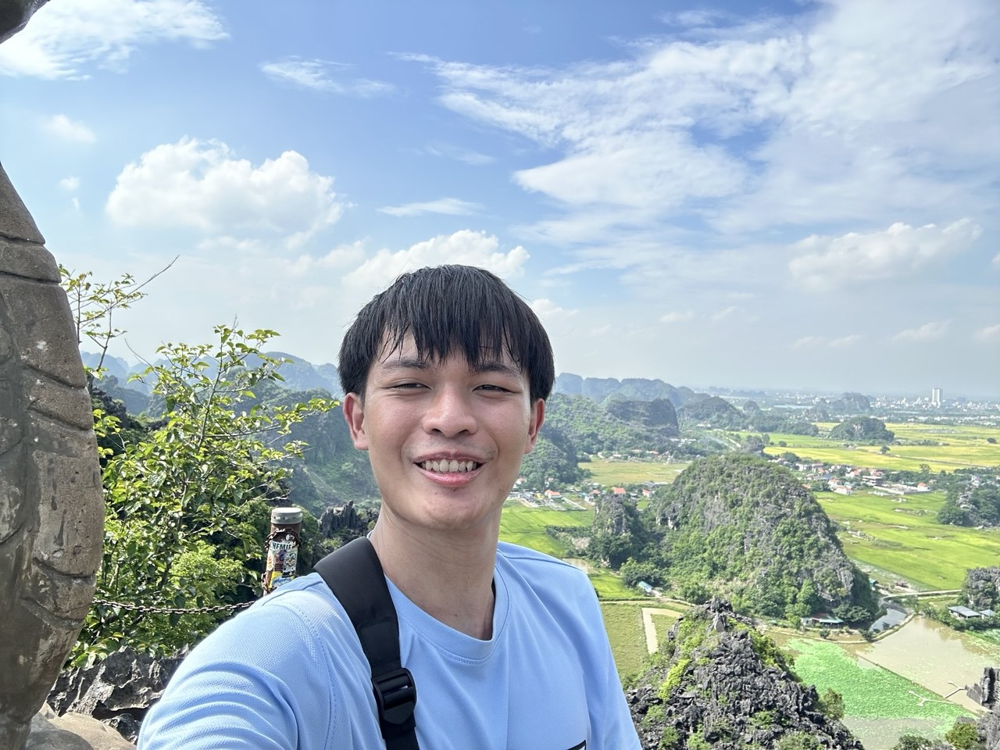
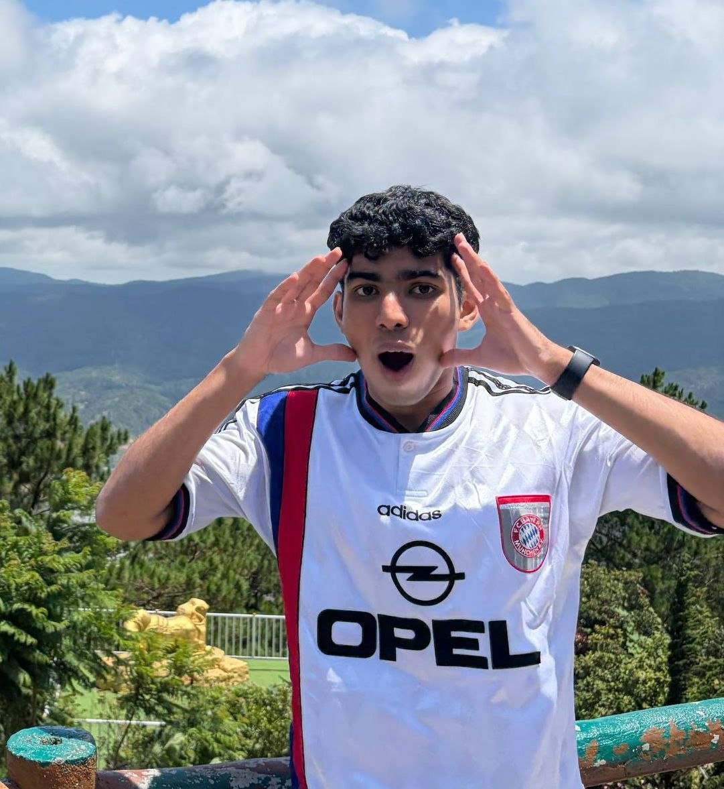
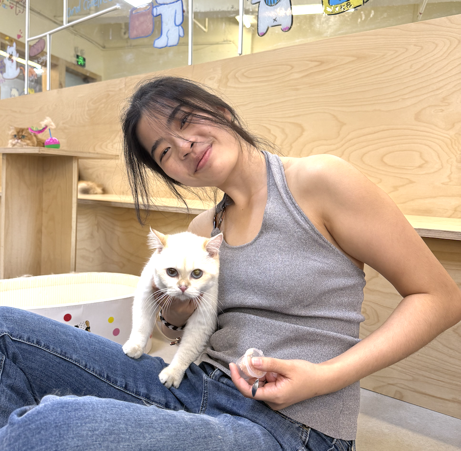
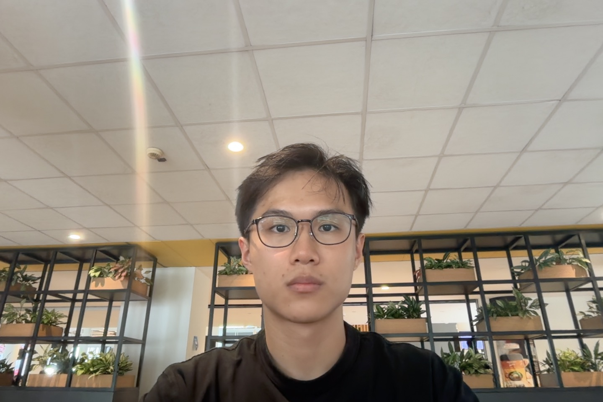
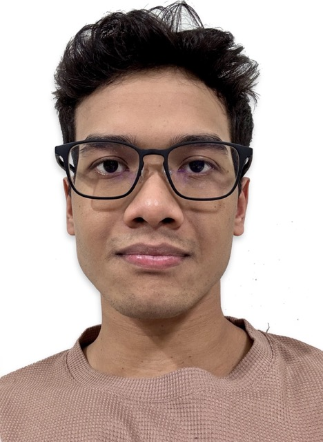

We are a team based in the [School of Computing, National University of Singapore](https://www.comp.nus.edu.sg).

For product questions and bug reports, use the [team issue tracker](https://github.com/AY2627S1-CS2103T-W13-3/tp/issues).

## Project team

Responsibilities below summarize the v1.3 implementation contributions; all members contribute reviews and testing.

### Josthan Wong

[[github](https://github.com/josthan12)]

* Role: Developer and Tester
* Responsibilities: Command parsing/routing, client profile retrieval and name search.

### Ayush Jain

[[github](https://github.com/Ayushjain8541)]

* Role: Developer and Tester
* Responsibilities: Client/follow-up domain rules, mutation commands and release preparation.

### Gwen Lim

[[github](https://github.com/gwenlim89)]

* Role: Developer and Tester
* Responsibilities: Displayed-list model, pending ordering and profile-selection lifecycle.

### Kin Chong

[[github](https://github.com/wkc75)]

* Role: Developer and Tester
* Responsibilities: Client workspace, pending-action rows and status presentation.

### Somaaditya Samal

[[github](https://github.com/SomaadityaSamal)]

* Role: Developer and Tester
* Responsibilities: Persistence and execution integration, client profile panel and workflow verification.
