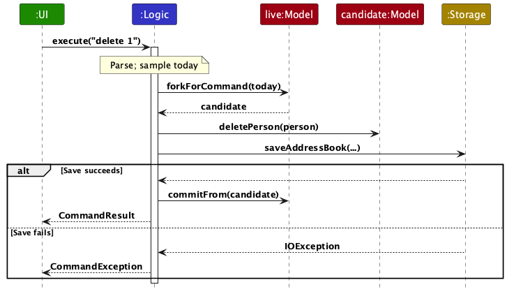
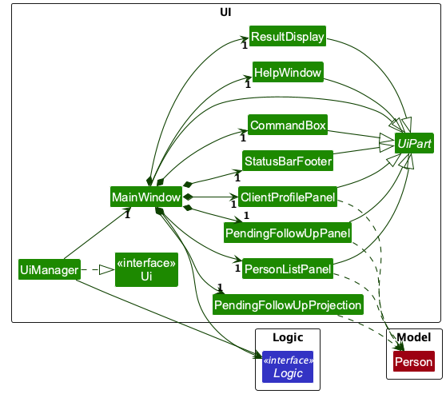
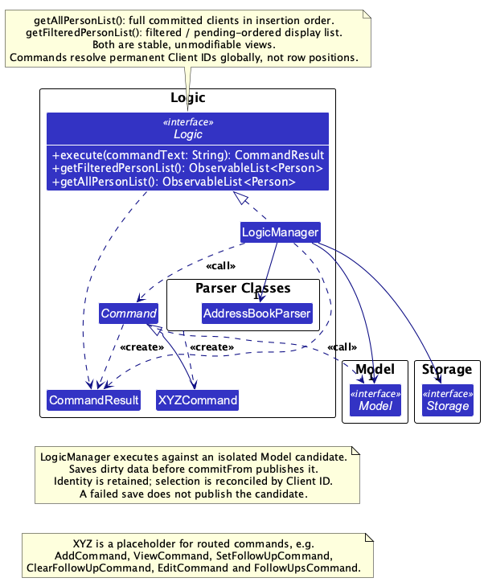
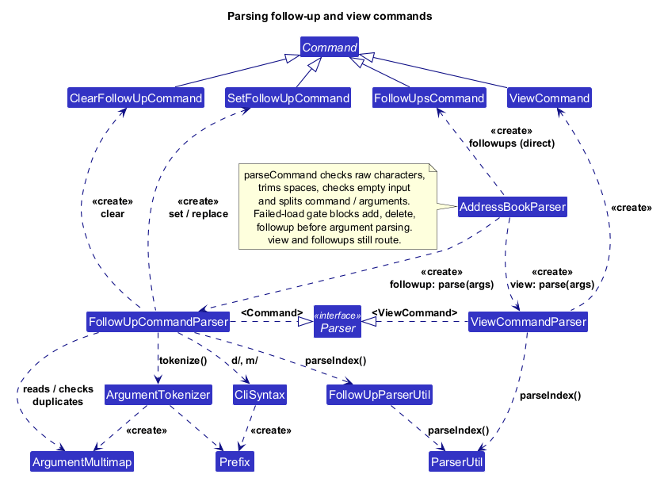
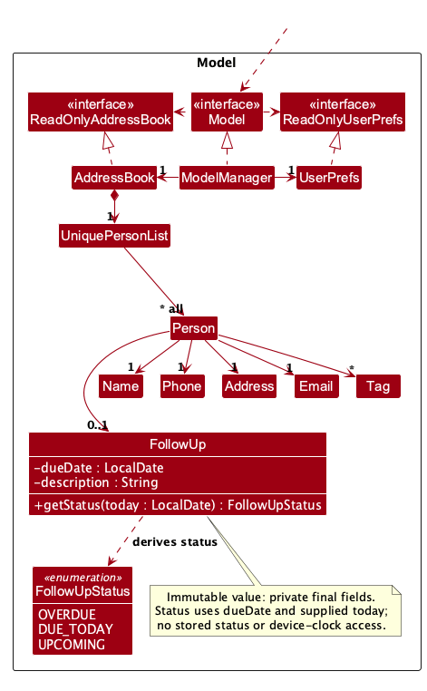
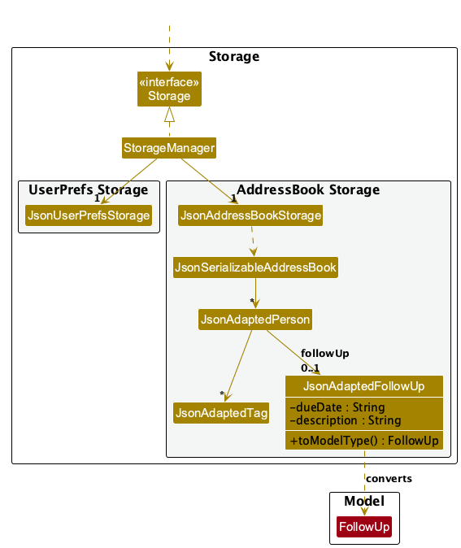

* Table of Contents
{:toc}

--------------------------------------------------------------------------------------------------------------------

## **Acknowledgements**

* PolicyHarbor adapts [AddressBook Level 3](https://github.com/se-edu/addressbook-level3), retaining its Java/JavaFX architecture and test conventions.
* All team members used ChatGPT for general assistance during the project.

--------------------------------------------------------------------------------------------------------------------

## **Setting up, getting started**

Refer to the guide [_Setting up and getting started_](SettingUp.md).

--------------------------------------------------------------------------------------------------------------------

## **Design**

<div markdown="span" class="alert alert-primary">

:bulb: **Tip:** The `.puml` files used to create diagrams are in `docs/diagrams`. Refer to the [_PlantUML Tutorial_ at se-edu/guides](https://se-education.org/guides/tutorials/plantUml.html) to learn how to create and edit diagrams.
</div>

### Architecture


The _**Architecture Diagram**_ given above explains the high-level design of the App.

The following provides a quick overview of the main components and their interactions.

**Main components of the architecture**

**`Main`** (consisting of classes [`Main`](https://github.com/AY2627S1-CS2103T-W13-3/tp/blob/master/src/main/java/seedu/address/Main.java) and [`MainApp`](https://github.com/AY2627S1-CS2103T-W13-3/tp/blob/master/src/main/java/seedu/address/MainApp.java)) is in charge of the app launch and shut down.

* At app launch, it initializes the other components in the correct sequence, and connects them up with each other.
* At shut down, it shuts down the other components and invokes cleanup methods where necessary.

The bulk of the app's work is done by the following four components:

* [**`UI`**](#ui-component): The UI of the App.
* [**`Logic`**](#logic-component): The command executor.
* [**`Model`**](#model-component): Holds the data of the App in memory.
* [**`Storage`**](#storage-component): Reads data from, and writes data to, the hard disk.

[**`Commons`**](#common-classes) represents a collection of classes used by multiple other components.

**How the architecture components interact with each other**

The _Sequence Diagram_ below shows how the components interact with each other for the scenario where the user issues the command `delete 1`.



Each of the four main components (also shown in the diagram above),

* defines its _API_ in an `interface` with the same name as the Component.
* provides its functionality through a concrete `{Component Name}Manager` class that implements the corresponding API interface.

For example, the `Logic` component defines its API in `Logic.java` and implements it in `LogicManager.java`. Other components interact with a component through its interface rather than its concrete class, preventing them from coupling to that component's implementation, as illustrated in the following partial class diagram.


The sections below give more details of each component.

### UI component

The **API** of this component is specified in [`Ui.java`](https://github.com/AY2627S1-CS2103T-W13-3/tp/blob/master/src/main/java/seedu/address/ui/Ui.java)



The UI consists of a `MainWindow` and its parts, including `CommandBox`, `ResultDisplay`, `PersonListPanel`, `ClientProfilePanel`, `PendingFollowUpPanel` and `StatusBarFooter`. All of these, including `MainWindow`, inherit from the abstract `UiPart` class, which captures common behavior among classes that represent visible GUI parts.

The `UI` component uses the JavaFX UI framework. The layouts of these UI parts are defined in matching `.fxml` files in `src/main/resources/view`. For example, [`MainWindow.fxml`](https://github.com/AY2627S1-CS2103T-W13-3/tp/blob/master/src/main/resources/view/MainWindow.fxml) specifies the layout of [`MainWindow`](https://github.com/AY2627S1-CS2103T-W13-3/tp/blob/master/src/main/java/seedu/address/ui/MainWindow.java).

The `UI` component,

* executes user commands using the `Logic` component.
* listens for changes to `Model` data so that the UI can be updated with the modified data.
* keeps a reference to the `Logic` component, because the `UI` relies on the `Logic` to execute commands.
* depends on some classes in the `Model` component because it displays `Person` objects from the model.

### Logic component

**API** : [`Logic.java`](https://github.com/AY2627S1-CS2103T-W13-3/tp/blob/master/src/main/java/seedu/address/logic/Logic.java)

Here's a (partial) class diagram of the `Logic` component:



The sequence diagram below illustrates the interactions within the `Logic` component, taking `execute("delete 1")` API call as an example.


How the `Logic` component works:

1. When `Logic` is called upon to execute a command, the command is passed to an `AddressBookParser` object, which in turn creates a parser that matches the command (e.g., `DeleteCommandParser`) and uses it to parse the command.
1. `LogicManager` samples a command date and forks an isolated model candidate. The parsed command executes against that candidate.
1. Dirty client data is saved before the candidate is published with `Model.commitFrom`. A parse, command or save failure discards the candidate and leaves the live state unchanged.
1. A successful read-only command publishes list/selection/date changes without saving. Its `CommandResult` supplies the feedback text returned to the UI.

Here are the other classes in `Logic` (omitted from the class diagram above) that are used for parsing a user command:



How the parsing works:

* When called upon to parse a user command, the `AddressBookParser` class creates an `XYZCommandParser` (`XYZ` is a placeholder for the specific command name, e.g., `AddCommandParser`). The parser uses the other classes shown above to parse the user command and create an `XYZCommand` object (e.g., `AddCommand`). The `AddressBookParser` returns that object as a `Command` object.
* All `XYZCommandParser` classes, such as `AddCommandParser` and `DeleteCommandParser`, implement the `Parser` interface so they can be treated similarly where appropriate, for example during testing.

### Model component

**API** : [`Model.java`](https://github.com/AY2627S1-CS2103T-W13-3/tp/blob/master/src/main/java/seedu/address/model/Model.java)



The `Model` component,

* stores the client data i.e., all `Person` objects (which are contained in a `UniquePersonList` object).
* derives one displayed list for full, search or pending mode and exposes a stable unmodifiable `ObservableList<Person>`.
* exposes read-only properties for the current date, pending-list mode and selected canonical client; these are session state and are not serialized.
* stores a `UserPrefs` object that represents the user’s preferences (currently, just the GUI settings). This is exposed to the outside as a `ReadOnlyUserPrefs` object.
* does not depend on any of the other three components (as the `Model` represents data entities of the domain, they should make sense on their own without depending on other components)

### Storage component

**API** : [`Storage.java`](https://github.com/AY2627S1-CS2103T-W13-3/tp/blob/master/src/main/java/seedu/address/storage/Storage.java)



The `Storage` component,

* can save both client data and user preference data in JSON format, and read them back into corresponding objects.
* is implemented by `StorageManager`, which delegates the actual JSON file access to `JsonAddressBookStorage` and `JsonUserPrefsStorage` (one class per data file).
* depends on some classes in the `Model` component (because the `Storage` component's job is to save/retrieve objects that belong to the `Model`)

### Common classes

Classes used by multiple components are in the `seedu.address.commons` package.

--------------------------------------------------------------------------------------------------------------------

## **Implementation**

This section describes some noteworthy details on how certain features are implemented.

### Client-record validation and duplicate rejection

Contact values remain immutable `Name`, `Phone`, `Email` and `Address` objects inside `Person`. Name and address constructors trim outer U+0020 spaces, retaining internal spaces and case. Shared parsers trim only U+0020 for all contact fields. Names accept Unicode letters and combining marks after letters, while keeping ASCII digits and ordinary spaces; tags use ASCII validation; phones accept ASCII digits with an optional leading `+` and single spaces or hyphens between digit groups. Addresses accept Unicode single-line text but reject C0/C1 controls and U+2028/U+2029. Email accepts repeated `+`, `_` and `-` in the local part and interior repeated hyphens in domain labels, while retaining the adjacent alphanumeric pair requirement in the final domain label and preserving stored case.

**Unicode client names.** `Name.isValidName` scans Unicode code points and rejects controls, invalid surrogate sequences and combining marks without a preceding letter. It retains the entered spelling. Duplicate-name comparison normalizes to NFC and collapses runs of ordinary spaces, then uses `equalsIgnoreCase` consistently with name search; name search normalizes both stored words and keywords to NFC before case-insensitive whole-word comparison. `NameTest`, `PersonTest`, `NameContainsKeywordsPredicateTest` and `JsonAdaptedPersonTest` cover acceptance, rejection and reconstruction.

**Persistable Unicode addresses.** `Address.isValidAddress` also rejects unpaired UTF-16 surrogates so accepted addresses can be encoded when saved as UTF-8.
Each high surrogate must be followed by a low surrogate; a low surrogate cannot appear on its own. The pairing scan takes O(n) time and O(1) extra space, preserving existing ordinary-space trimming and single-line restrictions.
Valid supplementary characters, including emoji, remain unchanged. A literal U+FFFD replacement character is valid text and is not rejected merely because the same character can result from a decoding error.
Both `ParserUtil.parseAddress` and `JsonAdaptedPerson.toModelType` use the domain validator, so command entry and saved-value loading enforce the same rule without changing the saved schema.
A JSON escape such as `\uD800` can be syntactically valid JSON but decode to an invalid address. The adapter rejects it through `IllegalValueException`; storage translates this to `DataLoadingException`, activating the existing empty, mutation-blocked startup path without overwriting the file or publishing earlier valid records.
`AddressTest` covers malformed pairs and valid boundary pairs. `SavedAddressRecoveryTest` checks whole-file rejection, blocked mutations and unchanged bytes, valid Unicode add/save/restart, and successful saving after an address is repaired and the app restarted.

**Email validation implementation.** `Email.isValidEmail` iteratively scans the local and domain parts, including the repeated punctuation rules, while preserving stored case and the existing length policy. Each character is examined a constant number of times, so validation takes O(n) time and O(1) auxiliary space for an address of length n. This avoids recursive regular-expression matching and its potential stack overflow on unusually long input. `EmailTest` covers valid, invalid and exceptionally long addresses; `MainAppTest.longEmail_addAndRestart_preservesSavedClient` checks a long address through command entry and save/load.

`Person.isDuplicateOf` implements normalized-name equality **AND** (same phone digits **OR** case-insensitive-email equality). `Phone` preserves the entered display format and uses exact equality for value comparison; duplicate rejection compares the digits only so alternate international formatting does not bypass it. Names are normalized only for this comparison: NFC composition and collapsed ordinary-space runs, compared with `equalsIgnoreCase`. Stored names remain unchanged. Address, tags and follow-up do not participate.

The relation is symmetric but **not transitive**. For a common name, record A `(111, one@example.com)` duplicates B `(111, two@example.com)`, and B duplicates C `(222, two@example.com)`, while A and C are allowed together. Consequently:

* `UniquePersonList.contains` checks for a duplicate against every existing record.
* `setPersons` checks every pair before replacing the list, so ordering cannot hide a conflict.
* `setPerson` resolves the target by full value equality, excludes only that full-list slot and checks the replacement against every other record before updating. Matching the old target does not bypass those checks.
* Follow-up-only replacements retain the contact fields and remain valid. Two same-name clients can coexist and be replaced or deleted independently.

`AddressBook` delegates to this collection path. Model mutations, command candidates and storage loading reuse the same rejection rule. No persistent client ID is introduced; selection tracks canonical immutable record instances.

**Alternatives considered:** name-only rejection prevents legitimate same-name clients. Redefining `Person.equals`/`hashCode` around duplicate rejection would violate equality's transitivity. Both are unsuitable. `Person.isSamePerson` retains exact stored-name matching for legacy callers; it is neither the duplicate predicate nor a stable record-identity key. `equals`/`hashCode` still include all stored fields and follow-up.

`Tag` normalizes validated ASCII values with `Locale.ROOT`, so sets deduplicate case variants. `Tag.formatTags(Set<Tag>)` is the shared display API: sorted bracketed lowercase values separated by one space, or `None`. `Messages.format(Person)` uses it and emits contact details only; add/delete feedback does not append follow-up information.

### Client command parsing and publication

`AddCommandParser` retains the existing tokenizer. It checks required prefixes and preamble before repeated required prefixes, then validates name, phone, email, address and tags in that order. Unrecognized prefixes remain part of the current field value. The model's check for duplicates across all client records follows parsing, even when the client is hidden by a filter. Successful addition resets the view to the full insertion-order list.

`DeleteCommandParser` checks for exactly one ordinary-space-separated token before calling `ParserUtil.parseIndex`. The shared helper accepts ASCII digits, trims outer U+0020, removes leading zeroes before bounded conversion and rejects values outside `1..2147483647` without leaking `NumberFormatException`. `FollowUpParserUtil` and `ViewCommandParser` use the same helper. Delete resolves an index against `Model.getFilteredPersonList`, retaining the active mode and deleting the full record with its action.

`StringUtil.trimOrdinarySpaces` is shared by command parsers, contact/follow-up validation and saved-person/tag adapters.
It scans the two outer boundaries for U+0020 instead of retrying a trailing-space regular expression at each internal space.
Internal spacing, case, non-ASCII characters and the existing validation order remain unchanged; tabs and other whitespace are not silently stripped by this helper.
The address validator still checks complete UTF-16 surrogate pairs, and stored values continue through the same domain rules as command input.
`LongWhitespaceCommandTest` exercises a long valid name through add, save/load and search, plus rejection of an overlength follow-up without changing saved bytes.
`StringUtilTest` checks the short-input contract, including empty/blank text, internal spaces, tabs, non-breaking spaces and Unicode text. Its large-string timing regression measures only the pure trim call; workflow correctness tests do not impose a disk-I/O deadline.

`LogicManager` executes against a candidate, saves dirty data, then publishes the candidate. Parsing, duplicate, index and save failures preserve live data, list mode/order, selection and date; successful read-only commands do not save.

Tests cover domain partitions, exact messages, validation precedence, normalized duplicates, the non-transitive conflict example, safe replacements, tag normalization, index boundaries and many leading zeroes. `ClientRecordCommandsTest` exercises the real dispatcher/model/Logic and temporary-file storage, including same-name round trips, pending/filter indices, follow-up targeting and injected save failures. Parser tests cover syntax separately from command displayed-range checks.

### Saved client loading

`Name` allows `/`, `-`, `'`, `@` and `.` after an initial English letter or digit, supporting local name forms while retaining existing case and spacing rules. The shared validator applies to command parsing and saved records; punctuation is retained on save/restart and in duplicate comparison. `s/o` and `d/o` are literal name text, since neither is an `add` field prefix.

`JsonAdaptedPerson` validates saved contact fields using the domain types after removing outer ordinary spaces, matching command input. `JsonAdaptedTag` validates tags before `Tag` converts them to lowercase; collecting them into a set removes case variants. Missing tags become an empty set. Optional follow-ups, including overdue dates, use the existing follow-up adapter.

`JsonSerializableAddressBook` converts every record before installing the list through `AddressBook.setPersons`. That central collection operation checks every pair with `Person.isDuplicateOf`, including the non-transitive case. Missing entries, invalid values and duplicates become loading failures. `JsonAddressBookStorage` translates them to `DataLoadingException`; `MainApp` then starts with an empty, mutation-blocked model while leaving the saved file unchanged. A repaired file loads on the next startup.

**Unknown client fields.** JSON loading rejects unrecognised properties at the address-book, client and follow-up levels, including `tag` and `followup` misspellings. This uses the same protected startup path and preserves the original bytes. Missing optional `tags` and `followUp` remain valid. `JsonAddressBookStorage` enables strict property checking on its JSON reader; preference loading keeps ignoring unknown properties for compatibility.

**Strict JSON parsing.** `JsonUtil.fromJsonString` reads one root value and checks that no additional tokens remain. Client-data reads opt into Jackson's `STRICT_DUPLICATE_DETECTION` on their parser, which rejects repeated property names within any one object, including nested objects and escaped spellings of the same name; the same property name in separate objects remains valid. Trailing non-whitespace content, including a second JSON value, causes loading to fail; trailing JSON whitespace remains valid. `JsonUtil.readJsonFile` also rejects a null root. These checks apply before saved client records are converted. A client-data loading failure follows the protected startup path above: the empty model blocks mutations and preserves the original file. Repair the file or restore a valid backup, then restart the application before resuming client modifications. `JsonUserPrefsStorage` retains the legacy last-value behavior for duplicate preference properties; the shared mapper is not configured globally for strict duplicate detection. `DuplicateJsonPreferencesTest` verifies that startup retains and saves those preferences instead of replacing them with defaults. `JsonDuplicatePropertyTest` covers property uniqueness and separate-object controls; `DuplicateJsonRecoveryTest` verifies protected startup, query access, blocked mutations, byte preservation and recovery after repair for duplicate root, client and follow-up properties.

**Private loading diagnostics.** Jackson parsing and mapping exceptions can contain source JSON, rejected field values and nested client details.
`JsonUtil.readJsonFile` therefore logs a fixed warning with the file path and the category `invalid JSON/data format or I/O failure`, without appending exception text or attaching a throwable to the log record.
The original `IOException` remains the cause of `DataLoadingException` for callers; retaining that chain does not make its messages or stack trace safe for ordinary logs.

`JsonDiagnosticPrivacyTest` captures real log records and checks their messages, attached throwables and formatted output against synthetic client canaries.
Its fixtures cover malformed client JSON, wrong client/preference types, a nested constructor failure and a directory-read failure, while checking exception types and preservation of input bytes.
`LoadingDiagnosticPrivacyTest` captures the shared logger across `MainApp`, storage and commands to verify protected startup without partial client publication, allowed queries, blocked mutations and safe diagnostics.
For a preference type-mapping failure, it checks default recovery and repair while valid client data stays byte-identical; invalid preference bytes may be replaced.
**Strict text decoding.** Saved-client loading follows these boundaries:

* `FileUtil.readFromFile` reads UTF-8 with malformed-input reporting. A stray continuation byte, truncated sequence or invalid leading byte raises an `IOException` before Jackson receives a changed string.
* `JsonUtil.readJsonFile` translates that I/O failure to `DataLoadingException`.
* `MainApp` enters the same protected startup path as invalid JSON. No client is partly loaded and the original bytes remain untouched.
* Valid UTF-8 Unicode, an intentionally encoded replacement character, JSON Unicode escapes and trailing JSON whitespace remain readable. Escaped invalid UTF-16 values are a separate domain-validation concern.

`FileUtilUtf8Test` checks the decoder partitions. `SavedDataEncodingRecoveryTest` checks protected commands, byte preservation and repair followed by a writable restart.

**Filesystem retry.** `LogicManager` saves a candidate model before publishing it. If the data directory has become a regular file, `JsonAddressBookStorage` fails before replacing the destination and `LogicManager` leaves the live model unchanged. `StorageDirectoryRecoveryTest` moves a disposable directory aside, observes the real save failure, restores the directory and retries successfully. This verifies the existing atomic-save boundary without adding another fallback writer.

**UTF-8 BOM compatibility.** `FileUtil.readFromFile` skips one U+FEFF only at the start of the decoded JSON text. Client data and preferences saved by BOM-producing editors load normally. Embedded U+FEFF values are retained, additional or misplaced BOMs remain invalid, and strict byte decoding and trailing-content checks still apply. Loading alone does not rewrite the file.

A saved record uses the following JSON shape. Tags are strings, not objects; omit `followUp` (or use `null`) when no action is pending. Do not add session selection or a computed status to the file.

```json
{
  "persons": [{
    "name": "Rachel Lim",
    "phone": "91234567",
    "email": "rachel@example.com",
    "address": "Blk 123",
    "tags": ["active", "health"],
    "followUp": {
      "dueDate": "2099-12-15",
      "description": "Discuss renewal options"
    }
  }]
}
```

### View parsing, name search and supported command routing

`ViewCommand`, `ViewCommandParser`, `FindCommand` and `AddressBookParser` use the shared index helper and model selection API. `Logic.selectedPersonProperty()` delegates to the live model, allowing the workspace and profile to observe the same selection.

#### View execution and error precedence

`ViewCommandParser` trims outer ordinary spaces (U+0020) and requires exactly one token. Missing or additional tokens produce `Invalid command format!` followed by a newline and `Usage: view INDEX`, before any index syntax check. It then calls `ParserUtil.parseIndex`, accepting ASCII digits with arbitrarily many leading zeroes and a numeric value in `1..2147483647`. Invalid syntax propagates the shared message unchanged: `Index must be a positive integer from 1 to 2147483647.`. It does not duplicate shared validation or wrap every parsing error as a usage error.

At execution, `ViewCommand` obtains `Model.getFilteredPersonList()` and checks the target against its current size. An index beyond the displayed list produces `The client index provided is invalid.`. Otherwise it passes the exact displayed `Person` instance to `Model.selectPerson` and returns an ordinary `CommandResult` containing `Showing client: NAME`. The name is feedback, not a selection identity key. No command-result field, callback or UI event is added.

The current list is authoritative in full, search and pending modes. Selection does not change data, order, mode or the dirty flag. Through the existing `LogicManager` execution path, the command selects on an isolated candidate; successful publication transfers selection and the sampled date without saving client data. A failed parse or range check publishes nothing. The command never samples a date itself.

#### Name-search behavior

`FindCommandParser` reports the exact usage `Usage: find KEYWORD [MORE_KEYWORDS]...` for empty arguments. After global validation, it trims only outer U+0020 and splits keywords on runs of ordinary spaces. Quotes and punctuation remain literal tokens. `NameContainsKeywordsPredicate` retains whole-word, case-insensitive OR matching against names; it adds no substring, tag or contact search.

`FindCommand` applies that predicate to the full dataset with `updateFilteredPersonList`, leaving pending mode and restoring insertion-order results. Each client appears once regardless of repeated keywords. It uses the existing shared count message, `%1$d client(s) listed!`. The model retains selection only if its exact record remains visible; search does not explicitly select any record or mark data dirty.

#### Dispatcher and loading protection

`AddressBookParser` rejects C0/C1 controls and U+2028/U+2029 on raw input, trims ordinary spaces, and rejects an empty line with `Enter a command.`. Command words are case-sensitive. Its supported routes are `add`, `delete`, `view`, `find`, `list`, `followup` and `followups`.

The mutation gate contains only `add`, `delete` and singular `followup`. In a failed-load session these routes report the existing changes-blocked diagnostic before command-specific parsing. Queries remain available, including normal view argument validation and the range error against an empty displayed list. Typed `edit`, standalone `clear`, `help` and `exit` reach the unknown-command result, `Unknown command.`, in both normal and blocked sessions. Global raw-character errors still have priority. `followup INDEX clear` remains a supported mutation.

Legacy command classes, their direct unit tests, the GUI Help menu and the window close handler remain available for their separate uses; removal applies to typed dispatch. Compatibility tests assert parse rejection for unsupported routes and retain failed-save/file-preservation checks for supported mutations.

#### Automated evidence

`ViewCommandParserTest` covers shape-before-syntax precedence, ASCII index boundaries and long leading-zero runs. `ViewCommandTest` uses date `2026-10-12` and two permitted same-name clients to verify exact displayed-record selection in full/search/pending modes, unchanged list/data/mode, failure preservation, and selection/date publication through Logic without a storage write.

`FindCommandParserTest`, `FindCommandTest` and `AddressBookParserTest` cover literal usage/result text, ordinary-space splitting, whole-word OR matching, insertion order, repeated keywords, all-data search after filtering/pending mode, selection reconciliation and global validation. Dispatcher tests reject all four unsupported routes in normal and blocked sessions and retain singular follow-up clearing. `LogicManagerTest` and `FollowUpWorkflowIntegrationTest` provide compatibility evidence for blocked-session rejection and preservation of state and saved bytes.

Command tests alone do not certify rendered profile behavior. The workspace and profile sections below describe the integrated UI and its separate checks.

### Client-profile selection model

`Model` and `ModelManager` own session selection. The integrated `view` command, Logic bridge and profile pane use this state instead of JavaFX row highlighting.

`Model.selectedPersonProperty()` returns one stable `ReadOnlyObjectProperty<Person>`. Its nullable value is the selected canonical record, with `null` meaning no selection. `Model.selectPerson(Person)` accepts a non-null object that is actually present in the current displayed list. An equal-valued copy is not a canonical member. Selection changes view state without marking client data dirty; the property does not expose a writable UI setter.

Selection follows the exact record, never its name, duplicate relation or displayed index. Immutable `Person` instances can be shared between model copies. When `setPerson(target, replacement)` replaces the selected record, the model tracks the replacement and retains it as the selection only if it remains visible. Filtering out or deleting the selected record clears selection. Clearing its follow-up retains selection in full/search mode but clears it in pending mode, where the record is no longer visible. Returning to the full list does not recreate a cleared selection. Addition reveals the full list without selecting the new record. Constructors start with no selection, including when data loading is blocked; selection is not stored in JSON or preferences.

#### Candidate copying and selection publication

`forkForCommand(today)` copies selection along with data and view state into a clean candidate. The candidate has its own observable list and properties, so selecting, replacing, filtering or deleting a record there does not change the live model. Discarding the candidate preserves live selection and the published date. Selection-only operations remain clean; an accepted data replacement remains dirty even when its stored values are unchanged.

After the caller has successfully saved any dirty candidate, `commitFrom(candidate)` publishes its data, mode, date and selection while retaining the live observable objects. It maps the selected candidate record's full-list position to the corresponding committed live record. This position is used only within that publication; it is not a persistent ID or a displayed row number.

This mapping matters for an identical follow-up replacement. The candidate may contain a new `Person` object with equal values, while publication skips resetting the live client data when it has equal values. Publishing the candidate object directly would leave selection pointing outside the live list. Mapping to the committed live record retains a canonical visible selection whether the data was reset or retained.

Profile scrolling is separate from model selection: `ClientProfilePanel` starts a different client's profile at its vertical minimum.
The UI compares unchanged name, phone, email, address and tags to retain the reading position across immutable follow-up replacements.
It does not compare names alone, so selecting a separate same-name client resets the scroll position.
This continuity check is only a presentation policy; canonical-record membership and selection still belong to the model.
Repeated views, date refreshes and failed commands do not reset the current profile; reopening a closed profile starts at the top.
`ClientProfileScrollTest` checks rendered scrolling, same-name clients and real Logic commands, including follow-up replacement and failed saving.

#### Selection transition evidence

`ClientProfileSelectionTest` covers model-level selection transitions using a fixed date of `2026-10-12`: same-name records, pending reordering, filter exclusion, follow-up clearing, deletion, candidate isolation and equal-value replacement. Canonical-object assertions distinguish correct record tracking from value equality. The existing model and pending-list suites provide regression coverage for the authoritative displayed list and stable due-date ordering.

These tests establish the model boundary. `ClientProfileWorkflowIntegrationTest` adds real-command checks for pending reordering, filter exclusion, full-list and pending-list clearing, failed-save preservation, restart, and a 50-client command sequence with rejected input and saved-byte checks. The manual testing appendix covers visual profile updates and window resizing.

### Integrated dashboard and data ownership

`MainWindow.fillInnerParts()` composes the command bar, feedback strip, numbered table, profile and grouped pending panel. Repeated initialization is rejected to prevent duplicate controls and subscriptions. The horizontal workspace divider and the vertical sidebar divider allocate space without changing the data or selection. Component FXML loads scoped styles; `Dashboard.css` owns host geometry and branding.

The left `PersonListPanel` receives only `logic.getFilteredPersonList()`. Its unsortable `TableView` uses continuous one-based command indices and variable-height cells that wrap names/contact values. Due/status columns are visible in pending mode. `createRowDisplay` derives text from immutable values and the published date. Recycled rows clear old graphics and status badges; `isViewed` uses reference identity. Table selection never writes model selection. At widths below the visible columns' minimum total, the resize policy permits horizontal scrolling instead of hiding the last columns.

The `#` column has a fixed 56-pixel width (equal minimum, preferred and maximum widths; not resizable). Index cells render plain `Labeled` text, which JavaFX clips with an ellipsis rather than wrapping. With the earlier 36–40 pixel width, row 1000 rendered as `1...` at the 1280x720/150% logical size, so the index a command needs was unreadable. The fixed width fits five-digit indices in the table font; widen it if supported lists can exceed 99,999 clients.

`Logic.getAllPersonList()` exposes the stable, unmodifiable complete committed feed independently of search/pending filters. `MainWindow` constructs one `PendingFollowUpProjection` from it. The projection keeps clients with a follow-up, sorts them stably by due date and retains the canonical `Person` references. It never reads the filtered command list or samples a clock. Candidate execution and failed saves cannot publish tentative records into this feed.

`PendingFollowUpPanel` observes the projection, `todayProperty()` and `selectedPersonProperty()`. It groups actions by status using the published date, retaining due-date order within groups. It displays full names, dates and action text without command indices. Its selection listener observes invalidation so an equal-valued replacement still updates the identity-based marker. Empty groups are unmanaged and the empty summary is explicit.

On window close or programmatic hiding, `MainWindow` disposes the panel and closes the projection. Both operations are idempotent and their callbacks guard against already-queued notifications after disposal. No independent timer or second client store is introduced.

#### Layout boundaries and acceptance tools

`DashboardLayoutBoundaryTest` composes a real `MainWindow` over temporary storage and lays it out at 853x480, 1536x864 and 1920x1080, the logical sizes of 1280x720 at 150%, 1920x1080 at 125% and 1920x1080 at 100%. It covers partitions that `DashboardIntegrationTest` does not: a 1,000-client table, long unbroken email and address values in the profile, 80 pending cards, and a 200-character action with a long name.

Its text assertions read each control's rendered `.text` node as well as `getText()`. JavaFX keeps the full value in the control while drawing an ellipsis-clipped string, so `getText()` alone cannot detect truncation. Width assertions compare a scroll pane's content with its viewport, because the profile and pending summary disable horizontal scrolling.

For many cards, the test asserts that scrolling reaches the end of the last card rather than that the card fits: at 853x480 the summary viewport (about 99 pixels) is shorter than one card. The sidebar divider is the user's remedy, so this is a documented limit rather than a defect.

`DisplayMatrixFixture` (in test sources) writes a 1,000-client data file into a fresh folder for packaged-JAR checks and refuses to overwrite an existing file. Client 1 carries long unbroken values, and every tenth client has a follow-up spread across all three statuses relative to a printed reference date (today by default, or an optional `yyyy-MM-dd` argument). The 1,000-client test reuses the same generator, so every test run validates the fixture data.

Logical scene sizes are not evidence of physical scaling, font substitution or OS window behaviour. Record packaged results per OS, JDK, physical resolution and scaling in the [v1.5 platform matrix](testing/v1.5/platform-matrix.md), keeping combinations nobody has run explicitly pending.

### Command submission and feedback

`CommandBox` routes the field's Enter action and the Run button through the same submission handler. Run is not a default button, preventing a second submission on Enter. Parse/command/save failures retain input and add one error style; success clears it. Focus returns to the command field so correction can continue. Diagnostic logs record only outcome and exception category, never raw commands or exception details containing client data.

`FollowUpCommandBoxTest` checks forwarding and exception propagation at the executor boundary; `CommandSubmissionTest` checks the shared FXML submission path, single execution, retained input and focus recovery.
Packaged acceptance must additionally exercise Enter and Run with valid and rejected commands, then correct the retained text without refocusing. Check the rendered feedback separately: a complete accessibility value or selectable message does not establish that its text is readable on screen.

`ResultDisplay.setFeedbackToUser` resets error state explicitly; `setErrorFeedbackToUser` enables an Error label and a CSS pseudo-class. `MainWindow.executeCommand` uses the error setter only in its exception branch. The message is never classified by its wording. The read-only TextArea wraps, scrolls and allows selection/copying without stealing command input focus. Required resources/injected controls are validated. JavaFX component tests reuse an existing toolkit rather than calling `Platform.startup` twice in one JVM.

The saved-data warning is a separate persistent label controlled by `logic.isDataLoadingBlocked()`. Normal and error feedback updates cannot clear it. The footer formats the real data path without modifying storage; its wrapped tooltip exposes the full path. Help remains available through F1/menu and supports keyboard copy/close.

### Client profile panel

`ClientProfilePanel` observes Logic's selected-client and published-date properties. It renders the immutable record without selecting, saving or sampling the device clock. Contact values and action text wrap in a scrollable card; lowercase tags are sorted chips, with `No tags` for an empty set. No selection clears the fields and shows `No client selected.`; no action shows `Follow-up: None`. Status derives from `FollowUp.getStatus(today)`.

`DashboardIntegrationTest` drives the real window, Logic, model and temporary JSON storage. It verifies global-summary independence from filtering, command indices after reordering, canonical profile retention, clear/delete, date-driven groups, failed-save byte/view preservation, error recovery, cleanup and logical layout sizes. A missing-screen test exercises the real window constructor without discarding preferences. `DashboardStartupIntegrationTest` loads malformed JSON through MainApp and checks that query success and rejected mutations cannot dismiss the persistent warning or populate the protected views. Component suites cover cell recycling, long values, feedback accessibility and command submission separately. JavaFX layout tests establish logical geometry; the final OS scaling matrix still requires manual evidence.

### Follow-up state and date handling

`Person` contains an optional immutable `FollowUp` with a `LocalDate` due date and an action description. Recording or replacing an action creates a new `Person` that preserves every contact field and tag; clearing removes the optional action. There is no action history or completion flag.

`FollowUpCommandParser` recognizes either `followup INDEX clear` or one date and one description prefix. Commands resolve the index against the current displayed list before validating a new date/action. New actions cannot be dated before the candidate's sampled date. Stored overdue actions remain valid: JSON conversion checks calendar/description validity without imposing a today-based restriction.

`ArgumentTokenizer` recognizes `d/` and `m/` anywhere they immediately follow an ordinary space (U+0020), including inside a description. It does not interpret quotation marks or provide prefix escaping. Repeating either prefix therefore fails duplicate-prefix validation before command execution; an existing action stays unchanged. For example, `m/Confirm d/m/y format` repeats `d/`, while `m/Confirm day/month/year format` and `m/Check ref:d/m/y` preserve the intended descriptions.

`showPendingFollowUps()` includes every client with an action and sorts by due date. Stable sorting preserves full-list insertion order on equal dates. Chronological order naturally groups overdue, due-today and upcoming actions. `FollowUpStatus` derives those labels from the due date and published date; neither status nor the selected client is stored in JSON.

`LogicManager` samples its injected clock once per command candidate. The date is published only when that command succeeds. Separately, `MainApp` refreshes the live date on startup, window focus and a one-minute timer, so statuses update across midnight without a command. A failed command does not itself advance the date; independent focus/timer refreshes can still occur. `MainAppTest` and `LogicManagerTest` cover these two date paths.

### Save-before-publish boundary

`LogicManager.execute` follows this sequence:

1. Parse against the startup loading gate.
2. Fork an isolated candidate with the sampled date.
3. Execute the command against the candidate.
4. Save the candidate only when its data is dirty.
5. Publish its data, preferences, mode, date and selection to the live model.

A save failure becomes `CommandException` with `MESSAGE_SAVE_FAILED` formatted with the storage destination; no candidate state is published. The message suggests checking directory access and free space without displaying exception text, which may contain client data. `JsonAddressBookStorage` writes a sibling temporary file, then replaces the destination with an atomic move. It rejects a symbolic-link destination before writing and checks again before replacement; these checks are best effort and cannot prevent an external process from swapping the path after the final check. Such a late swap can replace the link itself, but the atomic move does not write through to its target. The app does not synchronize with external filesystem writers; `LogicManager` shows a specific recovery message for that case. On failure it attempts to remove the temporary file and preserves the existing destination. Unsupported atomic replacement is reported as a save failure, rather than falling back to a partial write. See `JsonAddressBookStorageTest` for write/move and symlink failure coverage.

### Application instance ownership

Before loading preferences or client data, `MainApp.init()` acquires an exclusive operating-system file lock through `AppInstanceLock` on `.policyharbor.lock` in the working folder. A competing launch or lock I/O failure leaves the services uninitialized; `start()` explains the failure and exits. `stop()` skips preference writes for a blocked instance and releases an acquired lock after normal shutdown. Initialization failures also release it, and process termination releases the OS lock.

The marker is retained because deleting it could allow a new process to lock a replacement file while an existing process still owns the original. An in-process registry, keyed by the normalized path with its real parent directory, rejects duplicate acquisitions before opening another descriptor: on some systems, closing that second descriptor could release the first descriptor's OS lock. Separate working folders remain independent; this protects against concurrent PolicyHarbor instances rather than synchronizing external file edits.

`MainAppInstanceTest` and `AppInstanceLockTest` use separate JVMs to verify blocked launches preserve saved bytes, separate folders work independently, normal shutdown and abrupt exit release ownership, retained markers permit restart, and a rejected same-JVM acquisition does not release ownership to another process.

--------------------------------------------------------------------------------------------------------------------

## **Documentation, logging, testing, dev-ops**

* [Documentation guide](Documentation.md)
* [Testing guide](Testing.md)
* [Logging guide](Logging.md)
* [DevOps guide](DevOps.md)

### Diagnostic log fallback

`LogsCenter` installs the console handler before attempting to open its rotating `policyharbor.log` files.
If file-handler creation throws `IOException`, it emits a generic warning through the initialized base logger and continues with console logging.
The warning does not include exception details. Other initialization failures still propagate; this fallback does not make client-data or preference writes succeed in a read-only folder.

`LogsCenterTest` launches a fresh JVM per scenario so it exercises static initialization independently of shared test-runner logging.
It obstructs `policyharbor.log.0` with a directory and verifies successful initialization and subsequent stderr logging, alongside writable-file creation, append preservation and log-level checks.
For a packaged manual check, launch the JAR from a disposable writable folder containing a directory named `policyharbor.log.0`.
Expect the console warning followed by normal startup logging and the main window. Repeat from a fresh writable folder without the obstruction and confirm that `policyharbor.log.0` is created as a file.
On POSIX, also repeat from a disposable readable/searchable but non-writable folder (for example, mode `0500`), restoring its permissions afterwards; later data or preference write failures remain outside this fallback.

--------------------------------------------------------------------------------------------------------------------

**Blank Unicode addresses.** `Address.isValidAddress` requires at least one code point that is neither Unicode whitespace, a space character nor a formatting character. Non-breaking/full-width spaces and zero-width formatting characters alone (or mixed together) are rejected. Visible addresses retain their Unicode content, including internal separators and formatting used by scripts. Parser and storage adapters share this validator.


## **Appendix: Requirements**

### Product scope

**Target user profile**:

* is an individual insurance agent who manages their own client and prospect records
* personally keeps track of client contact details and the next action they need to take for each client
* uses a personal computer to manage client details and follow-ups
* needs to review which client follow-ups are due, upcoming, or overdue
* types quickly and prefers typed commands to mouse interactions

**Value proposition**: PolicyHarbor helps individual insurance agents keep client contact details and one pending next action per client organised in a keyboard driven desktop app, making follow-ups easier to review and manage.

### User stories

These stories are delivered in v1.3. The MVP deliberately limits each client to one pending action.

| Priority | As an insurance agent, I want to... | So that I can... |
| --- | --- | --- |
| High | add a client or prospect with contact details | keep their information in one place |
| High | list clients and search by name | find the record I need |
| High | view a client's complete profile | review context before making contact |
| High | delete an incorrect client record | remove inaccurate information |
| High | reload saved data after restarting | retain my work between sessions |
| High | record or replace a dated next action | remember an agreed commitment |
| High | review overdue, due-today and upcoming actions | prioritize follow-ups |
| High | clear a completed action | remove work that no longer needs attention |
| High | receive useful errors without losing data | correct mistakes safely |
| Medium | categorize clients with tags | keep relevant context in the profile |

Backlog ideas, outside v1.4: multiple actions/history, notifications, client archiving, import and richer filtering. They are not advertised as available commands.

### Use cases

The actor is an individual insurance agent and the system is PolicyHarbor. Each command is entered in one line; the app does not prompt for individual fields or confirmation.

**UC01 — Retrieve a client profile**

1. The agent lists all clients or searches their names.
2. The system displays matching clients with current row numbers.
3. The agent enters `view INDEX`.
4. The system opens that client's complete profile without changing saved data.

Extension: invalid syntax or a missing displayed index produces an error and preserves the current profile.

**UC02 — Add a client**

1. The agent submits `add` with contact details and optional tags.
2. The system validates the fields and checks the full dataset for duplicates.
3. The system saves the new record, then displays the full list and success feedback.

Extensions: invalid/duplicate data produces an error without changes. A save failure preserves the previous data and view. The agent can correct and resubmit the retained command text.

**UC03 — Delete a client**

1. The agent identifies the client in the displayed list.
2. The agent enters `delete INDEX`; opening a profile first is optional.
3. The system saves the removal of the client and their follow-up, then refreshes the current list. If that client was viewed, the profile closes.

Extensions: an invalid index or save failure leaves the original state intact.

**UC04 — Record or replace a follow-up**

1. The agent enters `followup INDEX d/DATE m/DESCRIPTION` for a displayed client.
2. The system validates the index, date and description.
3. The system saves the action and updates the list/profile, reordering pending rows when necessary.

Extensions: invalid input or saving failure preserves the previous action and view. Only one action is stored, so an accepted replacement overwrites the earlier action.

**UC05 — Clear a follow-up**

1. The agent enters `followup INDEX clear` for a displayed client.
2. The system saves removal of the pending action.
3. In pending mode the client leaves the list and their open profile closes; in full/search mode the client remains and their profile shows no action.

Extensions: an absent action, invalid index or save failure produces an error and preserves the original state.

### Non-Functional Requirements

1. Should work on Windows, Linux and macOS with Java `25`; macOS uses the prescribed Zulu JDK+FX distribution.

2. Target: hold 1000 clients without noticeable sluggishness in typical usage. The automated stress scenario uses 50 clients; it is not a benchmark proving this target.

3. A user with above-average typing speed for regular English text (i.e. not code or system administration commands) should be able to accomplish most tasks faster using commands than using the mouse.

4. Should respond to typical user commands such as adding, deleting, searching, viewing client records and updating follow-ups within 1 second under normal operating conditions.

5. Should preserve all successfully saved client information between application sessions, such that closing and reopening the application does not cause data loss.

6. Invalid commands or invalid user input should not modify existing client data and should result in a clear error message explaining how the input can be corrected.

7. Should be usable without an Internet connection for all core client-management functions.

8. Client data should be stored locally on the user's device and should not require a remote server for normal operation.

9. Should be distributable as a single executable JAR file without requiring a separate installation process.

10. The user interface should remain usable at common laptop screen resolutions, including `1280 × 720` at 150% scaling, and work well at `1920 × 1080` at 100%/125% scaling. These are manual verification targets.

11. Commonly used commands and command formats should remain consistent throughout the application to reduce the amount of relearning required from the user.

12. The application should be designed primarily for keyboard-based interaction, while still allowing mouse interaction where appropriate.

### Glossary

* **Client record**: The contact details stored for a client or prospective client
* **Follow up**: The next action an agent plans to take for a client, with a due date and description
* **Pending**: A follow-up that has been recorded and not yet cleared. It stays pending after its due date passes
* **Index**: The row number of a client in the list currently displayed.
* **Overdue**: A pending follow-up whose due date is before today
* **Due today**: A pending follow-up whose due date is today
* **Upcoming**: A pending follow-up whose due date is after today

--------------------------------------------------------------------------------------------------------------------

## **Appendix: Instructions for manual testing**

Test the packaged JAR in a fresh writable folder with Java 25 (the prescribed Zulu JDK+FX on Mac). Use synthetic clients and repeat each independent scenario from the specified starting state. These are procedures, not a claim that every platform/scaling combination has been tested.

### Startup, persistence and basic workflow

1. Launch `java -jar PolicyHarbor.jar` from the JAR's folder. Expect an empty list, `No client selected.` and no loading warning.
2. Enter these commands separately:

   ```text
   add n/Rachel Lim p/001 e/rachel@example.com a/Blk 123 t/HEALTH t/health t/active
   add n/Amanda Lee p/002 e/amanda@example.com a/Blk 456
   view 1
   ```

   Expect Rachel's contact fields, `Tags: [active] [health]` and `Follow-up: None` in the profile. Only Rachel's row is marked `VIEWING`.
3. Record Rachel's action for today + 2 days and Amanda's for today + 1 day using `followup INDEX d/DATE m/ACTION`. Use actual `YYYY-MM-DD` dates.
4. Enter `followups`, then `view 1`. Expect Amanda before Rachel, the correct profile, and continuous numbering. Replace Amanda's action with today's date to verify the `DUE TODAY` badge.
5. Close/relaunch from the same folder. Expect all contacts/actions in full insertion order and no profile selection. Resize/move the window, close/relaunch and verify window preferences.

### Concurrent launches and restart

1. In a disposable writable folder, launch the packaged JAR, add a fictional client and record a follow-up. Keep this window open and copy the saved client file for comparison.
2. From a second terminal in the same folder, launch the same JAR. Expect a startup error explaining that PolicyHarbor is already running. Dismiss it; the first window remains usable and the saved client file is unchanged. The rejected launch must not write preferences.
3. Close the first window and launch again from the same folder. Expect the client and follow-up to load, even though `.policyharbor.lock` remains. Repeat after terminating the owner process.
4. Launch the JAR from a separate disposable folder while the first is open. Expect an independent empty dataset. Do not delete or replace an active folder's lock marker.

### Profile transitions and displayed indices

From the two-client dataset above:

| Action | Expected result |
| --- | --- |
| `followups`, `view 1`, then replace row 1's action with a date later than Rachel's | Amanda moves after Rachel; her profile and `VIEWING` marker follow the record. |
| `followup 2 clear` after that reorder | Amanda leaves pending mode and her profile closes. |
| `list`, `view 2` | Amanda can be viewed again and shows `Follow-up: None`. |
| `find Rachel` | Only Rachel remains; Amanda's profile closes. |
| `list` | Both clients return; no profile reopens automatically. |
| `view 1`, then `delete 2` | Rachel remains viewed; deleting her neighbor does not change selection. |
| `delete 1` | Rachel and her action disappear and the profile clears. |

For same-name targeting, start fresh and add two Rachel Lim clients with different phone/email values. View/delete each displayed row and verify that only its record is affected.

### Search and validation

Start fresh with Rachel and Amanda from the basic workflow.

| Input | Expected result |
| --- | --- |
| `find lim AMANDA Lim` | `2 client(s) listed!`, Rachel then Amanda, each once. |
| `find Rach`, `find "Rachel"`, `find Rachel,`, `find rachel@example.com` | Each returns `0 client(s) listed!`; only whole name words match. |
| `find` | `Invalid command format!` then `Usage: find KEYWORD [MORE_KEYWORDS]...`. |
| `view 0 extra`, `delete 0 extra` | Format error and the corresponding usage, before index syntax. |
| `view 0`, `view 2147483648`, `delete 0` | `Index must be a positive integer from 1 to 2147483647.` |
| `view 2147483647` | `The client index provided is invalid.` |
| `edit 1 n/Changed`, `clear`, `help`, `exit` | `Unknown command.`; no client data changes and the window stays open. |
| `add n/RACHEL  LIM p/001 e/new@example.com a/Blk 9` | Duplicate error despite name case/spacing differences. |
| `add n/Rachel Lim p/003 e/RACHEL@EXAMPLE.COM a/Blk 9` | Duplicate error because email matching ignores case. |
| `add n/Rachel Lim p/003 e/other@example.com a/Blk 9` | Allowed: both phone and email differ. |
| `add a/ t/! e/bad p/12 n/Bad&` | Name constraint first; no record is added. |

After each rejected command, verify that the input stays editable/focused and the client data, list and selected profile are unchanged. On success the command box clears. Date preservation is checked per command; the independent focus/minute refresh can update displayed statuses.

### Reserved prefixes in follow-up descriptions

Start in a fresh folder and add Rachel and Amanda using only the two `add` commands from the basic workflow. Use the two sample dates consistently throughout this scenario. If needed, substitute today's date for the first and tomorrow's date for the second; this keeps the prefix checks independent of date-policy changes. Enter `list`, `view 1`, then `followup 1 d/2099-12-14 m/Call about renewal`. Expect Rachel's action to be recorded.

| Input | Expected result |
| --- | --- |
| `followup 1 d/2099-12-15 m/Confirm d/m/y format` | `Multiple values specified for the following single-valued field(s): d/` |
| `followup 1 d/2099-12-15 m/Confirm m/y format` | The same duplicate-field diagnostic ending in `m/`. |
| `followup 1 d/2099-12-15 m/"Confirm d/m/y format"` | The duplicate-field diagnostic ending in `d/`; quotation marks do not escape the internal prefix. |
| `followup 1 d/2099-12-15 m/"Confirm m/y format"` | The duplicate-field diagnostic ending in `m/`. |

After each rejection, confirm Rachel still has `Call about renewal` due on `2099-12-14` (or the substituted date), with the same displayed list and selected profile. Then enter `followup 1 d/2099-12-15 m/Confirm day/month/year format`; expect `Follow-up for Rachel Lim updated to 2099-12-15.` and the complete replacement description. Finally, `followup 1 d/2099-12-15 m/Check ref:d/m/y` must also succeed: an embedded `d/` without a preceding ordinary space is description text. Use the substituted date in these commands and expected results if necessary.

### Loading protection and saved-data compatibility

Close the app before editing its JSON; back up the file first.

1. Make one saved follow-up date earlier than today, retaining a valid ISO date and action. Restart and enter `followups`. Expect that action to load as `OVERDUE`.
2. Remove a record's optional `followUp` or `tags` field and restart. Expect no action/no tags for that client; legacy contact-only records load.
3. In a separate folder, corrupt the JSON or put an invalid/duplicate client in it. Restart. Expect an empty list and a persistent saved-data warning.
4. Enter `list`, `find Rachel` and `view 1`. Queries remain available; a valid view index gives the displayed-range error. The warning stays visible.
5. Try `add`, `delete` or `followup`. Expect the changes-blocked diagnostic before command-specific parsing. Confirm the invalid file's bytes are unchanged.
6. Close the app, restore the valid backup and relaunch. Expect normal writable operation.

### Window, help and long content

- Test full/search/pending modes, scrolling and empty lists. Ordinary rows show no action fields; reused/empty rows show no stale badge or `VIEWING` marker.
- Click/highlight another row while a profile is open. The viewed client must remain unchanged until a successful `view` command.
- Use a long address and an action up to 200 characters. Narrow the split panes and verify wrapping/scrolling and access to the command box and feedback.
- Check at 1920×1080 with 100%/125% scaling and at 1280×720 with 150% scaling on available platforms. Record any untested combinations.

Help window and data-file footer (automated tests cover only the URL constant and feedback text):

1. With focus in the command box, press F1. Expect Help to open with **Copy link** focused. Repeat from the Help menu.
2. Press Enter. Expect `Link copied.`. Paste elsewhere; expect `https://ay2627s1-cs2103t-w13-3.github.io/tp/UserGuide.html`.
3. Select the full URL in its field and copy it manually. The pasted text must match.
4. Where a platform or clipboard tool can reject writes, press **Copy link** again. Expect `Could not copy the link. Select it above and copy it instead.` Record whether this was exercised.
5. Press Esc. Expect Help to close. Press F1 again; the previous copy message is cleared.
6. Run `StatusBarFooterLongPathFixture` (in `src/test/java/seedu/address/ui`) from the IDE. It shows the footer for a path of about 200 characters. The footer must end with `addressbook.json`. Hovering it must show the full path wrapped within the screen, without clipping, until the pointer leaves. (The app always uses `data/addressbook.json`, so this path cannot be set through `preferences.json`.)

### Integrated v1.4 dashboard checks

Use a disposable folder and fictional clients. Add at least three clients and assign actions for today and a future date; use the automated fixed-date fixtures for overdue/date-boundary scenarios.

1. Run `list`, then `view 1`. Enter `find` with another client's name. Only the numbered table is filtered; the global pending summary retains all actions. The profile clears when its client leaves the command list.
2. Run `followups` and select a client with `view INDEX`. Replace their action with another valid date. The table renumbers in due-date order while the profile and VIEWING markers follow the same record. Clear the action in pending mode; that row and summary card disappear and selection clears.
3. Submit an invalid command using Enter and then Run. Each activation produces one result, keeps the exact input and restores typing focus. Correct it to `list`; the Error label and input clear. Select/copy a long multiline error and scroll to its final line.
4. Narrow the main divider and resize the window. Verify horizontal table scrolling, independently scrollable profile/summary and the vertical sidebar divider. At logical sizes corresponding to 1920x1080 at 100%/125% and 1280x720 at 150%, keep command submission, feedback and both views accessible. Record which real OS/scaling combinations were exercised in the [release GUI verification record](Testing.md#v14-release-gui-verification-record); untested combinations remain pending.
5. Close and restart the packaged JAR in the same folder. Clients/actions persist; session selection resets. Repeat with `java -ea -jar PolicyHarbor.jar` and confirm ordinary validation still works.

### v1.5 display matrix checks

Run these on each real OS and resolution/scaling combination available, and record the results in the [v1.5 platform matrix](testing/v1.5/platform-matrix.md).

1. Run `DisplayMatrixFixture` from the IDE with a fresh folder as its program argument. Copy the JAR there and launch it from a terminal in that folder.
2. Enter `list` and scroll to the end of the table. Row `1000` must be fully readable, without an ellipsis. Enter `view 1000`; expect `Showing client: Client 1000`.
3. Enter `view 1`. The long name, email and address must wrap inside the profile without an ellipsis, and the profile must scroll to the follow-up section.
4. Scroll the pending summary to its last upcoming card, then drag the sidebar divider both ways. Both panels must stay usable, and the command box and feedback must stay visible.

### Save failures and automated boundaries

`JsonAddressBookStorageTest` injects write/move failures. `ClientProfileWorkflowIntegrationTest` checks failed add/delete/action replacement/clearing without changing saved bytes, selection, list mode/order or date. `ClientRecordCommandsTest` covers additional duplicate and index partitions; `ClientProfileSelectionTest` covers canonical identity and equal-value publication.

For an optional manual failure check, keep the app open and make only its test `data` directory unwritable. Attempt a mutation. Expect `Could not save to data/addressbook.json. No changes were kept. Check that the data folder is writable and has free space, then try again.` with the previous data/list/profile retained. Restore directory permissions before continuing. Use disposable data; automated fault injection is the reproducible evidence where platform permissions differ.

### Inaccessible client data at startup

`JsonUtil.readJsonFile` returns an empty result only when `Files.notExists` establishes that the data file is absent.
When access prevents determining existence, both `Files.exists` and `Files.notExists` can return false; treating that case as a first launch could overwrite existing clients after access returns.
The reader instead attempts the load, allowing the existing I/O-to-`DataLoadingException` path to create a mutation-blocked model.
Restoring folder access does not unlock that model: the user must restart so that the original client data is loaded before changes resume.
`InaccessibleDataRecoveryTest` uses temporary POSIX directory permissions to verify protected startup, unchanged bytes after access returns, and successful recovery after restart.
The permission-specific cases skip on platforms without POSIX support or accounts that bypass the access restriction; existing missing-file tests retain portable first-launch coverage.
