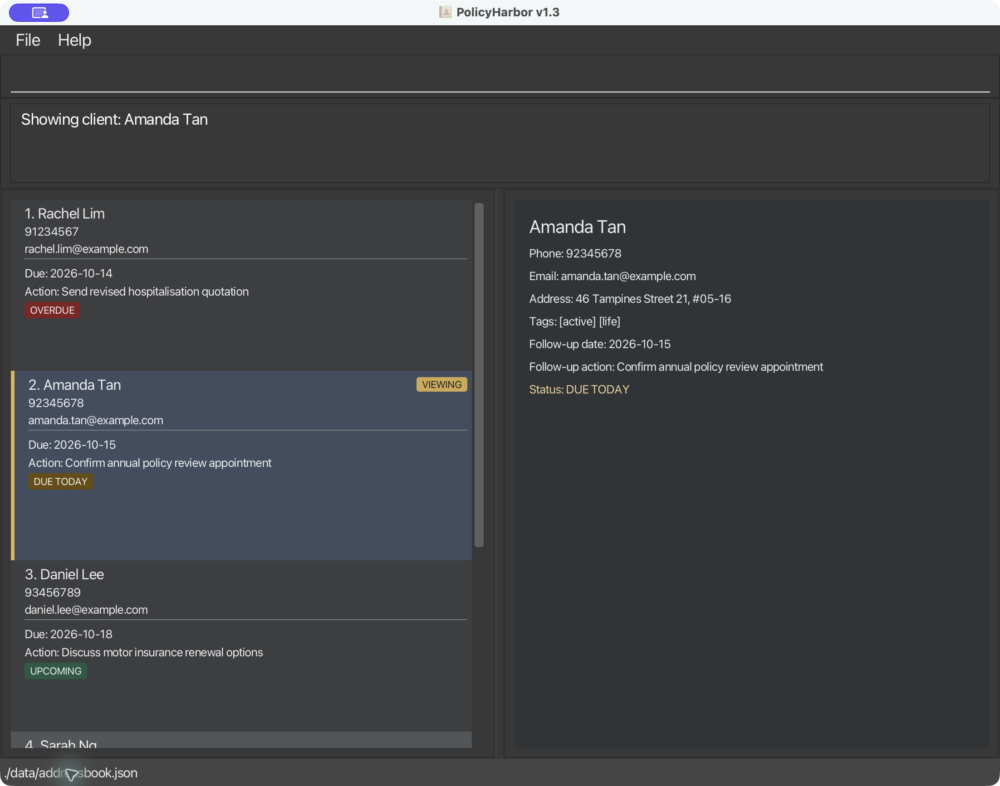
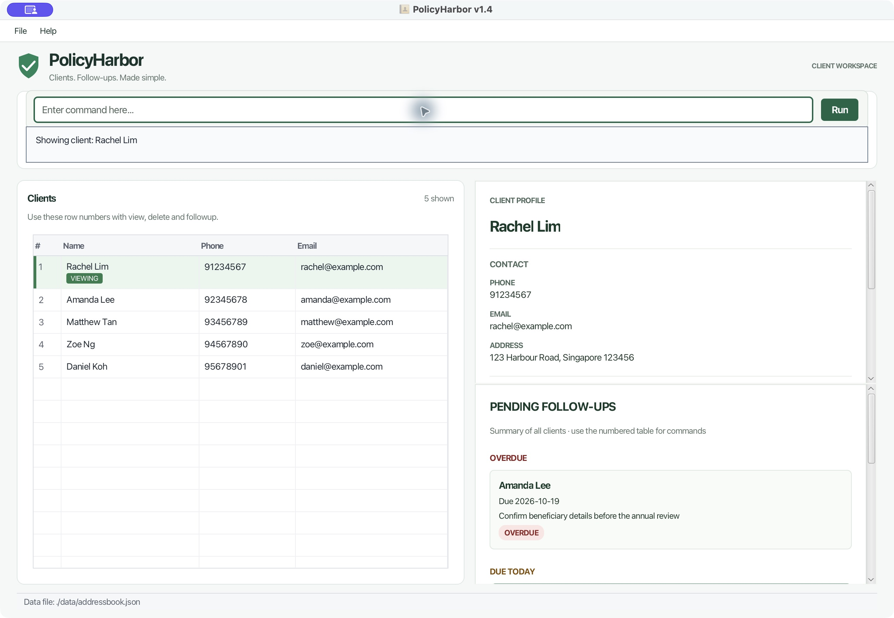

PolicyHarbor v1.4 is a desktop application for individual insurance agents to manage clients and their follow-ups. You enter commands in its command box and use the client list and profile panes to review the results.

* Table of Contents
{:toc}

--------------------------------------------------------------------------------------------------------------------

## Quick start

1. Ensure that Java `25` is installed on your computer.<br>
   **Mac users:** Ensure you have the precise JDK version prescribed [here](https://se-education.org/guides/tutorials/javaInstallationMac.html).

1. Download the latest `PolicyHarbor.jar` from the [team's releases page](https://github.com/AY2627S1-CS2103T-W13-3/tp/releases).

1. Copy the file to the folder where you want PolicyHarbor to store its data.

1. Open a terminal, `cd` to the folder containing the JAR file, and run `java -jar PolicyHarbor.jar`.<br>
   The client list is empty on first launch. Add a client to get started.

1. Enter each command below separately, pressing Enter or clicking **Run** after each one:

   ```text
   add n/Rachel Lim p/91234567 e/rachel@example.com a/Blk 123 t/health
   view 1
   followup 1 d/2099-12-15 m/Discuss renewal options
   followups
   ```

   Rachel's contact details appear in the profile pane. Her action appears in the pending summary with an `UPCOMING` badge. The example uses a future date; for your own actions use today or a later date in `YYYY-MM-DD` format.

1. Close the window and run the JAR again from the same folder. Rachel and her follow-up are restored; enter `view 1` to reopen her profile.

1. Refer to the [Features](#features) section below for details of each command.

--------------------------------------------------------------------------------------------------------------------

## Features

<div markdown="block" class="alert alert-info">

**:information_source: Notes about the command format:**<br>

* Words in `UPPER_CASE` are the parameters to be supplied by the user.<br>
  For example, in `add n/NAME`, replace `NAME` with a value such as `John Doe`.

* Items in square brackets are optional.<br>
  For example, `n/NAME [t/TAG]` can be used as `n/John Doe t/friend` or as `n/John Doe`.

* Items followed by `…`​ can appear zero or more times.<br>
  For example, `[t/TAG]…​` may be omitted, or written as `t/friend` or `t/friend t/family`.

* Parameters can be in any order.<br>
  For example, if the command specifies `n/NAME p/PHONE_NUMBER`, `p/PHONE_NUMBER n/NAME` is also acceptable.

* Extraneous ordinary text after `list` and `followups` is ignored.<br>
  For example, `list 123` is interpreted as `list`. Indexed commands such as `view` require their stated arguments.

* If you are using a PDF version of this document, be careful when copying and pasting commands that span multiple lines as space characters surrounding line-breaks may be omitted when copied over to the application.

</div>

### Reading the workspace

[](images/Ui.png)

*PolicyHarbor workspace with fictional clients. Open the image to enlarge it.*

The light dashboard keeps the command field, **Run** button and feedback strip at the top. Enter and Run submit the same current text once. A successful command clears the input; a rejected command keeps it for correction, marks the field and shows **Error** above the complete message. Editing clears the field's error style; the feedback remains until the next command. Long feedback wraps and can be scrolled, selected and copied.

* **Left: the numbered client table.** These are the indices used by `view`, `delete` and `followup`. It shows all clients after `list`, matches after `find`, and clients with follow-ups after `followups`. Columns cannot be sorted independently of command order. Narrow tables scroll horizontally.
* **Upper right: the selected client profile.** Use `view INDEX` to open a client's complete details. Long fields and tags wrap; scroll within the profile to read everything.
* **Lower right: all pending follow-ups.** This unnumbered summary always includes every client's action, even when the left table is filtered. It groups actions under `OVERDUE`, `DUE TODAY` and `UPCOMING`, with due-date order and insertion-order ties within each group. It does not provide indices for commands. Use `find` or `followups` and the left table to target a client.

Drag the main divider to change the table/sidebar widths. Drag the divider between the profile and pending summary to change their heights. Each right-hand panel scrolls independently.

The table shows row number, name, phone and email. In `followups` mode it also shows due date and status; read the full action in the sidebar or selected profile.

| Badge | Meaning |
| --- | --- |
| `OVERDUE` | The due date is before today. |
| `DUE TODAY` | The due date is today. |
| `UPCOMING` | The due date is after today. |

Follow-up statuses refresh automatically using the current date when PolicyHarbor starts, when the main window regains focus and once every minute while the application is running. You do not need to enter a command just to refresh the statuses.

In `followups` mode the table is ordered by due date, with insertion-order ties. Row numbers always run continuously from 1. The selected canonical client is marked `VIEWING` in the table and, if they have an action, in the summary. Clicking or highlighting either view does not select a profile or execute a command.

An empty table says `No clients to display.` or, in `followups` mode, `There are no pending follow-ups.`. An empty global summary has its own empty message. Finding no matches can leave an empty table alongside a populated summary; this is expected.

The footer identifies the local data file. When its path is shortened, hover over it to read the full path. The Help menu or `F1` opens the guide link, which can be selected or copied with **Copy link**; `Esc` closes Help.

If saved data could not be loaded at startup, a warning stays above the workspace for the whole session, whatever command you run. Close the app and restore a valid saved copy to clear it. An ordinary command error does not dismiss that warning.

### Supported commands

Command words are case-sensitive. The supported words are `add`, `delete`, `view`, `find`, `list`, `followup` and `followups`.

Typed `edit`, standalone `clear`, `help` and `exit` are unsupported and return exactly `Unknown command.`, even when saved data could not be loaded. Use `followup INDEX clear` to clear one client's follow-up; this remains supported. Close the application with the window's close button. The GUI Help menu and `F1` shortcut remain separate from typed commands.

Use one command line and ordinary spaces. Tabs, control characters and line separators are rejected before command recognition or argument validation. Blank input returns `Enter a command.`. For example, `VIEW 1` returns `Unknown command.` because `view` must be lowercase.

### Adding a client: `add`

Adds a client with their contact details and optional tags. A successful add returns to the full client list in insertion order; the new client has no follow-up yet.

Format: `add n/NAME p/PHONE_NUMBER e/EMAIL a/ADDRESS [t/TAG]...`

Supply each required prefix exactly once. The prefixes may appear in any order and must be preceded by an ordinary space. Tags may appear repeatedly and have no count limit. Outer ordinary spaces are removed from field values.

| Field | Accepted values |
| --- | --- |
| Name | Non-blank English letters, digits and ordinary spaces. Case and internal spaces are preserved. |
| Phone | At least three digits `0`–`9`. Leading zeroes are retained. |
| Email | Alphanumeric groups separated by single `+`, `_`, `.` or `-` before one `@`; domain labels contain alphanumeric groups separated by single hyphens and labels separated by dots. The final label must contain two adjacent letters or digits. Stored case is preserved. |
| Address | Non-empty single-line text, including punctuation, non-English text and emoji. |
| Tag | One or more English letters or digits. Tags are stored in lowercase; repeated case variants become one tag. |

Use one command line and ordinary spaces. Tabs, control characters and line separators are rejected. There are no additional contact-length limits.

A client is a duplicate when **their name matches and either their phone or email matches** an existing client. Names are compared ignoring English case and repeated ordinary spaces; phones match exactly, and emails ignore case. Address, tags and follow-up do not affect this check. Two clients may share a name if both their phone and email differ. Different names may share contact details. Duplicate checks include clients hidden by the current filter.

Examples, entered into a list without these clients:

* `add n/Rachel Lim p/001 e/Rachel@example.com a/Blk 123 t/HEALTH t/active t/health` adds Rachel and displays `Tags: [active] [health]`.
* `add n/Rachel Lim p/002 e/other@example.com a/新加坡 🏠` adds a second Rachel because both contact details differ.
* `add n/RACHEL  LIM p/001 e/new@example.com a/Another address` fails with `This client already exists in PolicyHarbor.` because the first Rachel has the same normalized name and phone.

Success text includes the name, phone, email, address and sorted lowercase bracketed tags separated by spaces. Without tags, it ends in `Tags: None`. For example:

```text
New client added: Rachel Lim; Phone: 001; Email: Rachel@example.com; Address: Blk 123; Tags: [active] [health]
```

A missing required prefix or extra text before the first prefix produces:

```text
Invalid command format!
Usage: add n/NAME p/PHONE_NUMBER e/EMAIL a/ADDRESS [t/TAG]...
```

If several fields are invalid, correct the reported error and submit the command again. Fields are checked in the order name, phone, email, address, then tags. An unrecognized prefix inside a field remains literal text: for example, `z/unit` inside an address is allowed, while the same text inside a phone makes the phone invalid.

Changes are saved before they appear in the list. If saving fails, the previous data and list remain and the result says `Changes could not be saved. No changes were kept. Try the command again.` If saved data could not be loaded at startup, adding clients is blocked to protect that file.

### Listing all clients: `list`

Shows all clients in insertion order and returns `Listed all clients.`. The open profile stays selected if its client is in the list.

Format: `list`

### Selecting a client: `view`

Selects the client at an index in the **currently displayed list** and returns `Showing client: NAME`, using the stored name without a trailing period. For Rachel Lim, the feedback is `Showing client: Rachel Lim`.

Format: `view INDEX`

Supply exactly one index containing digits `0`–`9`, with a value from `1` to `2147483647`. Leading zeroes are allowed, including long runs of zeroes: `view 02` and `view 0002` both mean `view 2`. The index must refer to an existing displayed row.

The command keeps client data, list mode, row order and numbering unchanged and does not save. After `find`, use search-result indices; after `followups`, use pending-list indices rather than full-list positions. Two same-name clients remain separate records even though their success feedback uses the same name.

Examples:

* `list` then `view 2` selects the second client in the full list, if present.
* `find Rachel` then `view 1` selects the first matching Rachel, if present.
* `followups` then `view 01` selects the first displayed pending client, if present.

| Input problem | Exact result |
| --- | --- |
| Missing index or extra tokens, such as `view 0 extra` | `Invalid command format!` followed by a newline and `Usage: view INDEX` |
| One invalid index token, such as `0`, `-1`, `1.5`, `abc` or `2147483648` | `Index must be a positive integer from 1 to 2147483647.` |
| Valid index beyond the displayed list | `The client index provided is invalid.` |

Missing or extra tokens take priority over index syntax; valid syntax is checked before the displayed-list range. A failed view preserves the previous selection, list and displayed date. In a failed-load session, `view` is still allowed: a valid index produces the range error against the empty list rather than a mutation-blocked message.

On success, `view` opens the selected client's full profile in the right pane and marks the matching row `VIEWING`.

[](images/ClientProfile.png)

### Locating clients by name: `find`

Searches all clients' names, including clients hidden by a prior search or pending list, and displays matches in their original insertion order. It leaves pending mode and returns `COUNT client(s) listed!`, for example `2 client(s) listed!` or `0 client(s) listed!`.

Format: `find KEYWORD [MORE_KEYWORDS]...`

* Matching is case-insensitive: `rachel` matches `Rachel`.
* Only whole words match: `Rach` does not match `Rachel`.
* A client matching any keyword appears once (an OR search). Keyword order and repeated keywords do not change the result order.
* Only names are searched; phone, email, address and tags are not searched.
* Separate keywords with ordinary spaces. Multiple ordinary spaces are allowed. Quotes and punctuation are literal: `find "Rachel"` and `find Rachel,` do not match the name `Rachel Lim`.

For a dataset containing Rachel Lim and Amanda Lee, `find rachel AMANDA` returns both in insertion order. `find Lim` returns Rachel Lim; `find Rach` returns no matches unless another client has that exact name word.

A missing keyword produces exactly these two lines:

```text
Invalid command format!
Usage: find KEYWORD [MORE_KEYWORDS]...
```

Search does not change client data or save it. The selected client remains selected only while present in the results; searching them out clears selection. A later search does not automatically select them again.

### Deleting a client: `delete`

Deletes the client at an index in the **currently displayed list**. After `find`, use the search-result indices; after `followups`, use the pending list's due-date order. Deleting a client also removes their follow-up. The active list mode remains unchanged and its rows are renumbered.

Format: `delete INDEX`

Supply exactly one index, using digits `0`–`9`, from `1` to `2147483647`. Leading zeroes are allowed: `delete 02` means `delete 2`. The index must also refer to an existing displayed row.

Examples:

* `list` followed by `delete 2` deletes the second client in the full list.
* `find Rachel` followed by `delete 1` deletes the first Rachel shown, preserving any other same-name client.
* `followups` followed by `delete 01` deletes the first pending client shown, even if that client occupies another position in the full list.

Success text uses the deleted client's contact details and sorted tags, without their follow-up. For example:

```text
Deleted client: Rachel Lim; Phone: 001; Email: Rachel@example.com; Address: Blk 123; Tags: [active] [health]
```

| Input problem | Result |
| --- | --- |
| Missing index or extra tokens, such as `delete 0 extra` | `Invalid command format!` followed by a newline and `Usage: delete INDEX` |
| One invalid index token, such as `0`, `-1`, `abc`, `1.5` or `2147483648` | `Index must be a positive integer from 1 to 2147483647.` |
| Valid index beyond the displayed list | `The client index provided is invalid.` |

Shape errors take priority over index syntax. A rejected delete leaves data, the current list and date unchanged. A save failure also keeps the previous state and reports `Changes could not be saved. No changes were kept. Try the command again.` Deletion is blocked if saved data could not be loaded at startup.

### Keeping the same client profile open

Use `view INDEX` to select a client in the currently displayed list. The right pane updates with that client's details.

The profile shows the selected client's name, phone, email, address and tags. Tags appear as chips in lowercase alphabetical order, or as `No tags` when there are no tags. A pending follow-up shows its date, full action text and `OVERDUE`, `DUE TODAY` or `UPCOMING` status. With no follow-up it shows `Follow-up: None`; with no selected client it shows `No client selected.`

Your open profile will follow the client, even when their row number changes. Two clients with the same name will have separate profiles. Only a successful `view` command will open a profile; adding a client or highlighting a row will not open one automatically.

| Change | Result for your open profile |
| --- | --- |
| Show the full list or add a client | Keep the same client open. |
| Search or show pending follow-ups | Keep the client open only if they remain in the displayed list; otherwise close the profile. |
| Record or replace that client's follow-up | Update their profile and keep it open, even if the pending list moves their row. |
| Clear that client's follow-up in the full list or search results | Keep their profile open without a follow-up. |
| Clear that client's follow-up in the pending list | Close their profile because the client leaves the pending list. |
| Delete the open client | Close their profile; do not open the client who inherits their row number. |
| Delete another client or change another client's follow-up | Keep the same client open despite any renumbering. |

Once a profile closes because its client leaves the list, returning to the full list will not reopen it. You will need another successful `view` command. Reopening the application also starts without an open profile. A failed command or failed save leaves the previous profile unchanged.

### Recording or replacing a follow-up: `followup`

Records one pending action for the client at an index in the **currently displayed list**, or replaces that client's existing action.

Format: `followup INDEX d/DATE m/DESCRIPTION`

Use a calendar date in `YYYY-MM-DD` format. A new or replacement date may be today or later; past dates are rejected with `Follow-up date cannot be in the past.` An already saved follow-up can become overdue as time passes. The description must contain 1–200 printable English ASCII characters after outer ordinary spaces are removed. Its internal spaces are retained.

For example, `followup 2 d/2099-12-15 m/Discuss renewal options` records the action for the second displayed client, provided that date has not passed. Success reports `Follow-up for NAME recorded for DATE.` or `Follow-up for NAME updated to DATE.` The list and profile refresh immediately. In the pending list, changing the due date may move the client to another row; the open profile stays with that client.

An invalid displayed index is reported before an invalid date or description. Invalid input and failed saves leave the previous follow-up and list unchanged.

### Clearing a follow-up: `followup INDEX clear`

Removes the pending action for the client at an index in the **currently displayed list**. Success reports `Follow-up for NAME cleared.` If the client has no pending action, the result is `This client has no pending follow-up.` In pending mode, a cleared client disappears from the list; in the full list or search results, the client remains visible. A failed save preserves the action.

### Showing pending follow-ups: `followups`

Shows only clients with pending actions, ordered by ascending due date. Clients with the same due date retain their original insertion order. The feedback is `Pending follow-ups`, or `There are no pending follow-ups.` if none remain. Use the indices **shown in this list** for `view`, `delete` and singular `followup`. `list` returns to the full list, and `find` searches all clients even if they were hidden in pending mode.

### Saving the data

PolicyHarbor automatically saves successful client and follow-up changes. `list`, `find`, `view` and `followups` do not rewrite the data file. You do not need a save command. The selected profile is session-only.

Close the app before copying `data/addressbook.json` to a backup location. Restore a backup while the app is closed, then restart from the JAR folder.

### Editing the data file

Client data is saved automatically as `data/addressbook.json` relative to the folder from which you run `java -jar PolicyHarbor.jar`. Advanced users can update it directly by editing that file.

<div markdown="span" class="alert alert-warning">:exclamation: **Caution:**
If the data file contains an invalid client or duplicate clients, PolicyHarbor starts with an empty displayed list and blocks client changes. It does not overwrite or partly load the invalid file. Correct the file or restore a backup, then restart the app. Back up the file before editing it.<br>
Names, addresses, phone numbers, email addresses and tags follow the same validation rules used when adding a client. Outer ordinary spaces are removed; tags are stored in lowercase without duplicates. Missing tags mean no tags. Existing valid overdue follow-ups are preserved.
</div>

--------------------------------------------------------------------------------------------------------------------

## FAQ

**Q**: How do I transfer my data to another computer?<br>
**A**: Close the app on both computers. Place the JAR in a writable folder on the new computer and create a `data` subfolder. Copy the old `data/addressbook.json` into it, backing up any existing destination file first. Run the JAR from the new folder with Java 25.

--------------------------------------------------------------------------------------------------------------------

## Troubleshooting and known limitations

* **If the app does not start on macOS:** follow the [SE-EDU setup guide](https://se-education.org/guides/tutorials/javaInstallationMac.html) to install and activate Zulu Java 25 with JavaFX. Check `java -version` and `which java` in the same terminal, then run `java -jar PolicyHarbor.jar`. A different active Java installation may cause JavaFX loading errors.
* **Saved-data warning:** close the app, back up `data/addressbook.json`, then repair it or restore a valid backup. Restart to reload; query commands cannot remove the warning.
* **MVP scope:** one pending follow-up per client. Follow-up history, notifications, archiving and typed contact editing are not provided in v1.4.


* **Window restoration:** PolicyHarbor restores the window on its saved screen when that screen is available. If the saved screen is unavailable, startup fits the window inside the primary screen's usable area. You do not need to delete `preferences.json` when disconnecting a secondary screen.
* **If you minimize the Help Window** and then use the `Help` menu or the keyboard shortcut `F1` again, the original Help Window will remain minimized, and no new Help Window will appear. The remedy is to manually restore the minimized Help Window.

--------------------------------------------------------------------------------------------------------------------

## Command summary

Action | Format, Examples
-------- | ------------------
**Add** | `add n/NAME p/PHONE_NUMBER e/EMAIL a/ADDRESS [t/TAG]...` <br> e.g., `add n/James Ho p/22224444 e/jamesho@example.com a/123, Clementi Rd, 1234665 t/friend t/colleague`
**Delete** | `delete INDEX`<br> e.g., `delete 3`
**View** | `view INDEX`<br> e.g., `view 02`
**Find** | `find KEYWORD [MORE_KEYWORDS]...`<br> e.g., `find James Jake`
**List** | `list`
**Record or replace follow-up** | `followup INDEX d/DATE m/DESCRIPTION`
**Clear follow-up** | `followup INDEX clear`
**Pending follow-ups** | `followups`

Typed `edit`, standalone `clear`, `help` and `exit` return `Unknown command.`. Use the window's close button to exit.
