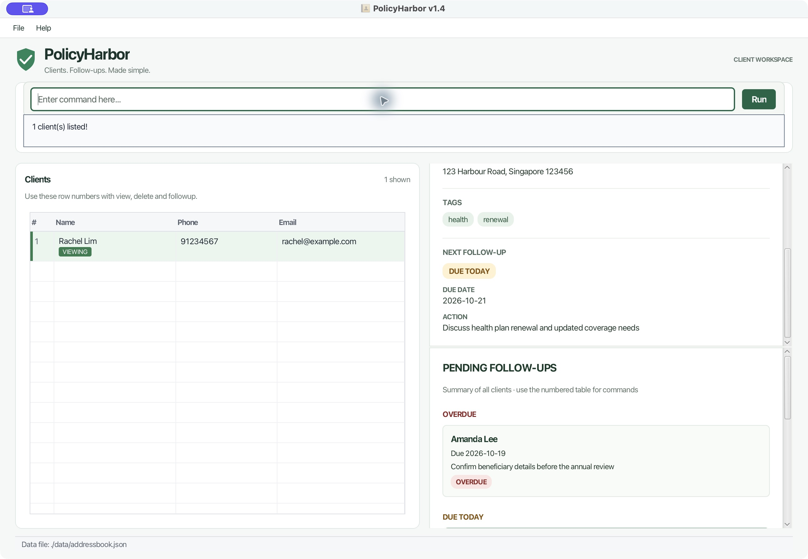
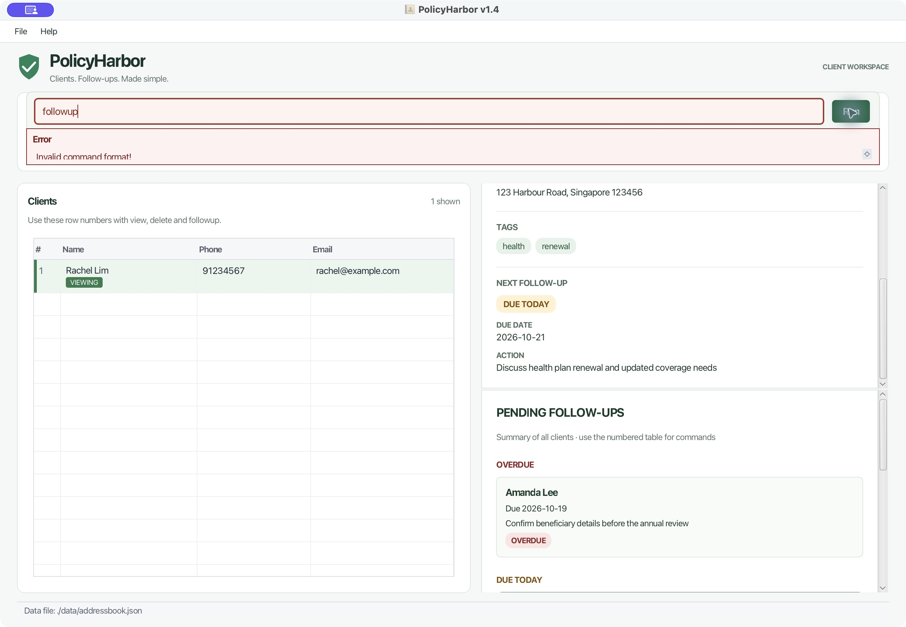

## What's new since v1.3.1

- **A light dashboard for daily client work.** A branded header, command bar, numbered client table and independently scrollable profile/follow-up panels replace the previous workspace. Drag the main and sidebar dividers to allocate space.
- **All pending actions stay visible while searching.** The new unnumbered sidebar includes every client's pending action, grouped into Overdue, Due Today and Upcoming. Filtering the table does not hide other clients' upcoming work. Each card includes the full action and due date.
- **A compact client table with safe command indices.** Names and contact values wrap; pending mode adds due-date and status columns. Sorting is disabled so displayed row numbers always match `view`, `delete` and `followup`. Narrow tables scroll horizontally.
- **A clearer selected-client profile.** Contact fields, sorted tag chips and the next follow-up appear in a light card. VIEWING markers follow the selected record across follow-up reordering, including clients who share a name.
- **Run commands with Enter or Run.** Both use the same submission path. Failed commands retain their input and restore typing focus; successful commands clear it.
- **Readable success and error feedback.** A compact, read-only strip wraps and scrolls complete messages. Errors have a text label as well as color; the next successful command clears the error state. The saved-data warning remains separate and persistent.
- **Refreshed Help and data-file information.** Help offers a selectable guide link, a Copy link button and Escape-to-close. The footer exposes long data paths in a wrapped tooltip.
- **Integrated regression protection.** Tests cover the complete feed, stable pending projection, view/selection consistency, save-failure isolation, date refresh and window cleanup. Developer runs and tests enable assertions without requiring users to launch with them.
- **Safer saved-data loading.** JSON files with trailing non-whitespace content or additional root values are rejected instead of partially accepted. Invalid saved client data starts a protected session that blocks changes and preserves the original file.
- **More reliable email validation.** Iterative character scanning preserves the supported client email formats while avoiding stack overflow on unusually long inputs.

The existing seven commands and local JSON format are preserved. Each client still has one pending action; multiple actions, history, notifications and typed contact editing are outside this release.

## Screenshots

The screenshots use fictional clients in the packaged application.

## Running the app

Use Java 25 and run `java -jar PolicyHarbor.jar` from a writable folder. Mac users should follow the prescribed JDK+FX setup linked in the [User Guide](../UserGuide.html#quick-start). Client data remains in `data/addressbook.json`; keep a backup before replacing an earlier JAR.
